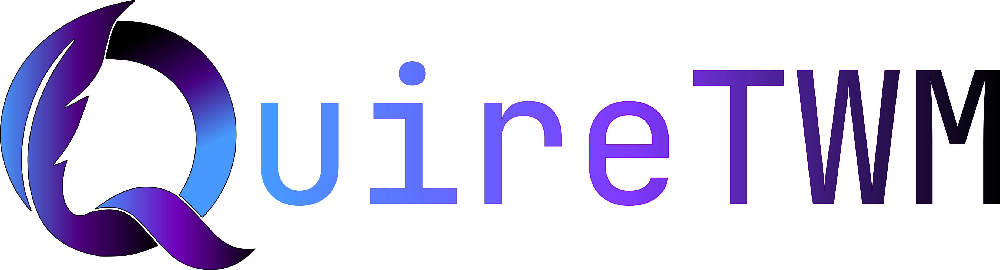

<p align="center">
  
</p>

<h1 align="center">QuireTWM</h1>

*A scrollable ribbon tiling window manager for Windows 10 and 11. Built with C++ and Lua.*

Inspired by scrollable Wayland compositors like Niri, QuireTWM replaces rigid grid splits with an infinite horizontal ribbon. The screen acts as a moving camera tracking your focused column, backed by sub-stepped numerical spring physics.

https://github.com/user-attachments/assets/782fd7da-b258-4ee8-b321-5c79d84c64f7

---

<h1 align="center">Highlights</h1>

* **Scrollable Ribbon**: Windows sit in vertical columns along an unbounded horizontal axis. Focus smoothly glides the viewport.
* **Vertical Workspaces**: Workspaces stack on the Y-axis. Switching slides the viewport vertically without window teleport glitches.
* **Spring Dynamics**: Configurable mass, stiffness and damping drive every movement.
* **Direct2D Hardware Overlay**: Draws rounded active borders, HUD status and Alt-Tab cards at display refresh rate.
* **Zero Window Bleed**: Safely parks inactive workspace clients to avoid coordinate corruption.
* **Lua 5.4 Scripting**: Expressive configuration and keybindings via Sol2.
* **Built-in Alt-Tab & Launcher**: Fast overlay switcher and app menu out of the box.

---

<h1 align="center">Architecture</h1>

1. **Layout Engine**: Windows live in dynamic columns. Each column can host multiple vertically stacked windows. The camera tracks focused elements along the horizontal plane.
2. **Event Pipeline**: Tracks system windows out-of-context via `SetWinEventHook` and handles keyboard shortcuts via low-level hooks. Frameless apps like Discord, VS Code and Spotify work correctly without child-window glitches.
3. **IPC Server**: Background worker thread listens on `\\.\pipe\quire` for fast external automation from PowerShell or shell scripts.

---

<h1 align="center">Requirements</h1>

* Windows 10 or 11 (x64)
* Visual Studio 2022 (MSVC v143+) or C++ Build Tools
* CMake 3.20+
* Windows SDK (Direct2D, DirectWrite, DWM)

---

<h1 align="center">Quick start</h1>

```cmd
git clone https://github.com/ewasion137/QuireTWM.git
cd QuireTWM
cmake -B build -A x64
cmake --build build --config Release
```

The binary and scripts will land in `build/Release/`. Launch `QuireTWM.exe` to run.

---

<h1 align="center">Configuration</h1>

Your config lives at `%USERPROFILE%\.quire\config.lua`. Changes reload automatically on save.
You can setup it manually or use [our site](https://ewasion137.github.io/Quire) to generate a config (Open the Config Generator tab.)

---

<h1 align="center">Keybinds</h1>

| Shortcut | Action |
| :--- | :--- |
| `Alt + H / L` | Focus left or right column |
| `Alt + K / J` | Focus upper or lower window in stack |
| `Alt + Shift + H / L` | Shift current column left or right |
| `Alt + D` | Cycle width preset (100% / 66% / 50%) |
| `Alt + V` | Toggle floating state |
| `Alt + F` | Toggle fullscreen view |
| `Alt + Q` | Close focused window |
| `Alt + Space` | Toggle launcher |
| `Alt + 1..9` | Switch to workspace |
| `Alt + Shift + 1..9` | Send window to workspace |

---

<h1 align="center">IPC</h1>

Send raw commands directly through the named pipe `\\.\pipe\quire`:

```powershell
# Send commands using PowerShell
.\quirectl.ps1 focus right
.\quirectl.ps1 workspace 2
.\quirectl.ps1 preset
.\quirectl.ps1 clients
```

Supported commands: `focus <dir>`, `move <dir>`, `preset`, `workspace <id>`, `movetoworkspace <id>`, `togglefloating`, `fullscreen`, `reload`, `close` and `clients`.

<h1 align="center">Visit our site.</h1>
<h3 align="center">https://ewasion137.github.io/Quire</h3>
